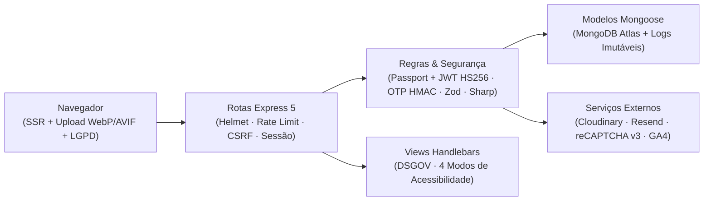

<div align="center">

# Portal Voz Ativa

**Ouvidoria cívica, denúncias sigilosas e vitrine de serviços locais para Cariús (CE).**

[](./PORTAL_VOZ_ATIVA.pdf)
[](https://portal-voz-ativa.vercel.app)
[](#estrutura-do-projeto)
[](#)

[Acessar o Portal](https://portal-voz-ativa.vercel.app) · [Abrir PDF do Projeto](./PORTAL_VOZ_ATIVA.pdf) · [Arquitetura](#arquitetura-e-fluxo) · [Estrutura de Pastas](#estrutura-do-projeto) · [Equipe](#equipe)

</div>

<br>

> [!NOTE]
> O código-fonte da aplicação (`dhiogoFrutuoso/Portal-Voz-Ativa`) passou a ser **privado**. Este repositório público existe para preservar a documentação do projeto, o PDF de apresentação e a organização real de diretórios do sistema — sem código-fonte exposto.

---

## Contexto

O **Portal Voz Ativa** nasceu em **Cariús (CE)** como uma iniciativa independente de tecnologia social para aproximar moradores, prestadores de serviço e demandas da cidade em um só lugar. Em 2025, o projeto venceu o programa **Ceará de Valores** (**1º lugar estadual**, **1º lugar na regional de Iguatu** e premiação de **R$ 20.000,00**).

| Eixo | Para quem é | O que resolve na prática |
| :--- | :--- | :--- |
| **Gestão de Melhorias** | Moradores de Cariús | Registro de problemas urbanos (vias, iluminação, espaços públicos) com mapa/GPS, protocolo e linha do tempo de acompanhamento. |
| **Denúncias Sigilosas** | Cidadãos em relatos sensíveis | Canal reservado para ocorrências e queimadas com mascaramento de identidade (`isConfidential`), sigilo de autoria e geração de comprovante/relatório. |
| **Vitrine do Trabalhador** | Autônomos e clientes locais | Divulgação gratuita de mão de obra e serviços da região, sem intermediários nem taxas. |

*Base conceitual inspirada em Amartya Sen ("o desenvolvimento deve ser avaliado pela expansão das liberdades humanas"), Aristóteles, Paulo Freire, Hannah Arendt e Pierre Lévy.*

---

## Arquitetura e Fluxo

A aplicação segue o padrão **MVC em Node.js com renderização no servidor (SSR)** via Express 5 e Handlebars, preparada para rodar em ambiente serverless na Vercel com ativos estáticos separados na CDN.



### Decisões de engenharia e acessibilidade

- **Design System & 4 Modos Visuais:** interface inspirada no padrão gov.br (DSGOV) com alternância independente e combinada entre **Padrão Claro**, **Alto Contraste Claro**, **Modo Escuro** e **Modo Escuro + Alto Contraste**.
- **Sessão, Identidade e OTP:** autenticação via Passport + sessões persistidas no MongoDB (`connect-mongo`), tokens JWT `HS256` com `tokenVersion` para revogação de sessões e códigos OTP com hash HMAC-SHA-256, expiração e limite atômico de tentativas.
- **Pipeline de Mídia:** compressão prévia no cliente e reprocessamento no servidor com `sharp` (conversão WebP/AVIF com remoção de EXIF), validação de assinatura de arquivos/PDFs e entrega via Cloudinary.
- **Auditoria, Privacidade e SEO:** registro separado de eventos (`AuditLog`, `ActivityLog`, `AccessLog`), consentimento de cookies LGPD integrado ao Google Analytics 4 (Consent Mode v2), página `404` dedicada, `robots.txt` e `sitemap.xml`.

---

## Estrutura do Projeto

Cada pasta deste repositório espelha exatamente a organização real do projeto por meio de marcadores `.gitkeep`, mantendo o código-fonte protegido no repositório privado.

| Diretório | Papel na arquitetura |
| :--- | :--- |
| `src/config/` | Conexão com MongoDB, configuração de sessão, autenticação Passport, cabeçalhos de segurança e rate limiting. |
| `src/routes/` | Controladores HTTP divididos por domínio (`categories`, `protocolos`, `conta`, `user`, `uploads`, `edicao`, `legal`, `project` e `admin`). |
| `src/models/` | Schemas Mongoose para usuários, ocorrências/melhorias, denúncias, vitrine, recibos de mídia, OTP e trilhas de auditoria/logs. |
| `src/helpers/` | Validadores Zod, emissão/verificação de OTP, envio de e-mail, filtro de conteúdo, tratamento de mídia/uploads e middlewares de autorização. |
| `src/views/` | Layouts, parciais reutilizáveis e templates Handlebars agrupados por módulo, fluxo de protocolo, painel administrativo e páginas legais/erro. |
| `src/public/` | Origem dos arquivos estáticos (CSS dos 4 modos visuais, ilustrações WebP, JS de upload e PDFs), replicados para CDN no build. |
| `scripts/` | Utilitários de migração, conversão WebP, preparação de deploy (`build`) e suíte automatizada (`testes/`). |
| `docs/` | Documentação operacional de deploy na Vercel e decisões de governança/segurança. |

<details>
<summary><strong>Expandir árvore completa de diretórios espelhada</strong></summary>

```text
Portal-Voz-Ativa-Docs/
├── PORTAL_VOZ_ATIVA.pdf
├── README.md
├── docs/
├── scripts/
│   └── testes/
└── src/
    ├── config/
    ├── helpers/
    ├── models/
    ├── public/
    │   ├── css/
    │   ├── img/
    │   ├── js/
    │   └── pdf/
    ├── routes/
    └── views/
        ├── admin/
        ├── categories/
        │   ├── denuncias_sigilosas/
        │   ├── gestao_de_melhorias/
        │   └── vitrine_do_trabalhador/
        ├── errors/
        ├── layouts/
        ├── legal/
        ├── partials/
        ├── project/
        ├── protocolos/
        └── users/
```

</details>

---

## Stack Utilizada

| Camada | Tecnologias |
| :--- | :--- |
| **Backend & Templates** | Node.js `24.x`, Express `5`, Express-Handlebars, Zod |
| **Banco & Sessão** | MongoDB, Mongoose `6`, `connect-mongo`, MongoDB Memory Server (testes) |
| **Segurança & Auth** | Passport.js (`passport-local`), JWT (`HS256`), `bcryptjs`, `helmet`, `express-rate-limit`, Google reCAPTCHA v3 |
| **Mídia, PDF & E-mail** | Multer, Sharp, Cloudinary, `pdf-lib`, Resend |
| **Hospedagem & Analytics** | Vercel (Serverless Functions + CDN), Google Analytics 4 (Consent Mode v2) |

---

## Equipe

| Função | Integrantes |
| :--- | :--- |
| **Idealização e Coordenação Geral** | José Dhiogo Frutuoso Da Silva |
| **Desenvolvimento** | Erik Mateus Vieira Carneiro · Filipe Gomes do Nascimento · Lawan Kelve Duarte Freitas · Lucas Teixeira Gomes |

---

<div align="center">

**[portal-voz-ativa.vercel.app](https://portal-voz-ativa.vercel.app)** · **[Apresentação completa em PDF](./PORTAL_VOZ_ATIVA.pdf)**

<sub>Cariús, Ceará · Ceará de Valores 2025</sub>

</div>
